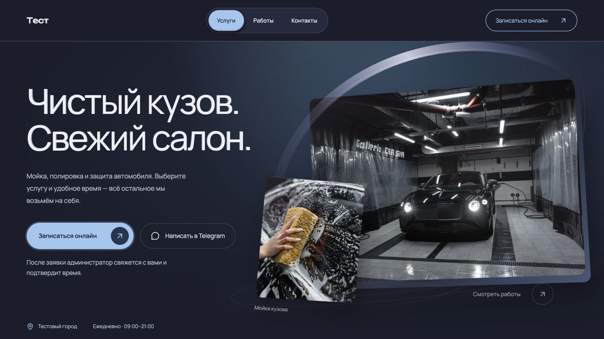

# FORMA

[← Все проекты](../README.md) · [Открыть демонстрацию](https://forma.154-86-119-94.sslip.io/p/test)

Шаблон сайта услуг и рабочее пространство студии: подготовка сайта, согласование, публикация и обработка заявок.

## Клиентский сайт

Услуги и цены, фотографии, галерея, контакты и форма выбора услуги и свободного времени. Фотографии показывают реальную мойку, полировку и уход за автомобилем.

## Работа студии

Настройка бренда, контента, каталога и расписания; согласование версии по ссылке; публикация; кабинет заявок с изменением статуса и Telegram-уведомлениями. Изменения контента в текущем предложении выполняет разработчик через рабочее пространство студии.

**Стек:** Next.js, React, TypeScript, SQLite.

Сайт по ссылке — демонстрация. Он не подтверждает заказ, партнёрство или одобрение Galleria Car Spa. Съёмка Tima Miroshnichenko и Zac Nielson используется по условиям Pexels и Unsplash; [источники](../ASSET_SOURCES.md). Адрес и цены в демо иллюстративные. Не оформляйте через эту демонстрацию реальный визит.
