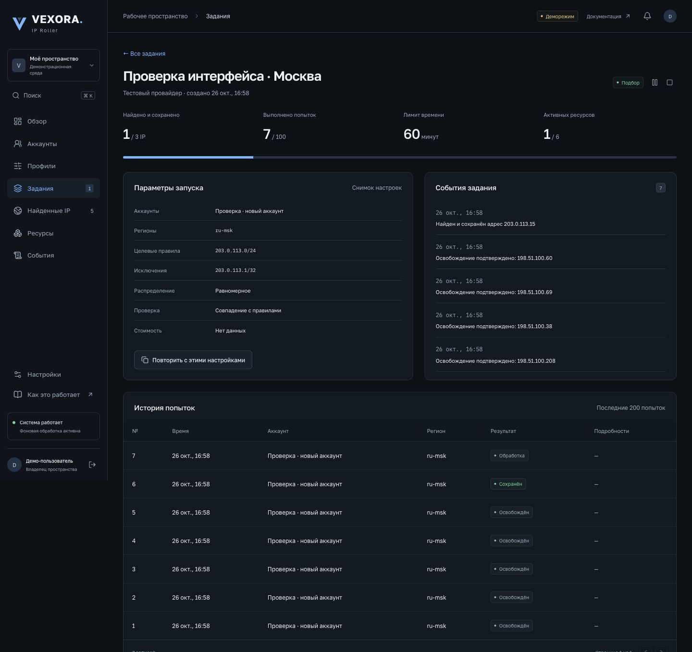

# VEXORA IP Roller

[← Все проекты](../README.md)

Панель управления облачными IPv4 с веб-интерфейсом и Telegram-управлением. Несколько облачных аккаунтов, правила IP/CIDR, независимые лимиты, фоновые задания и история событий.

Реализованы профили запуска, лимиты попыток и ресурсов, проверка правил без выделения IP, остановка и пауза заданий, экспорт результатов, внешние проверки через probe. Веб-панель и бот используют единое состояние; прогресс передаётся через SSE.

**Стек:** React, TypeScript, FastAPI, PostgreSQL, Celery, Redis, Docker Compose.

**Граница проверки:** локальная демонстрация использует тестовый адаптер и документационные диапазоны IP. Реальные аккаунты провайдеров не проверены; попадание в CIDR не равно подтверждённой доступности из сети пользователя. Код и публичный сервер этого проекта здесь не опубликованы.
